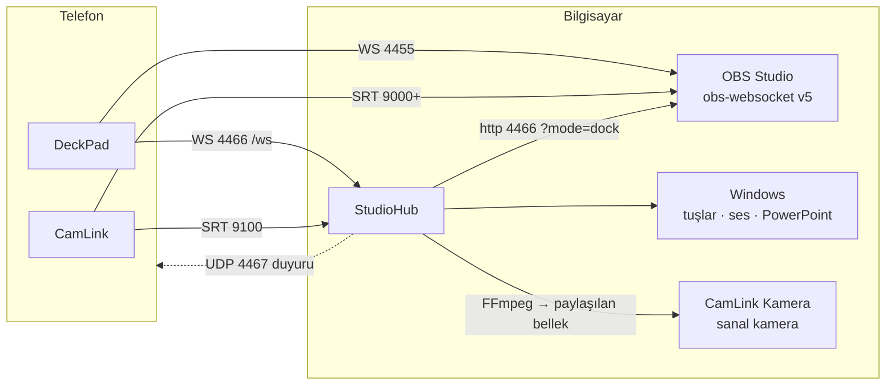

# DeckPad

Telefonu OBS için bir Stream Deck'e çeviren Android uygulaması ve onun Windows yardımcısı **StudioHub**.
Tuşlar düzenlenebilir: sahne, kayıt/yayın, ses efektleri, slaytlar, filtreler ve çok adımlı makrolar.
StudioHub açıksa aynı tuşlar bilgisayarda da iş görür: sunumu ilerletme, klavye kısayolları, medya, Windows ses düzeyi.


Kardeş depo **[camlink](https://github.com/MihrimatriX/camlink)**: telefonu kablosuz kameraya çeviren uygulama ve CamLink OBS eklentisi.
StudioHub iki uygulamaya da hizmet eder; OBS'siz webcam alıcısı bu depodadır.

## Bu depoda

| Klasör | Ne | Teknoloji |
|---|---|---|
| [`app/`](app/) | **DeckPad**: telefon uygulaması; aynı kod bilgisayar paneli olarak web'e de derlenir | Expo SDK 58, React Native 0.88, TypeScript, zustand |
| [`studiohub/`](studiohub/) | **StudioHub**: Windows yardımcısı (bilgisayar eylemleri, OBS'siz webcam, masaüstü/OBS paneli, OBS'i hazırla) | .NET 10, ASP.NET Core (Kestrel), WPF + WebView2 |
| [`obs-script/`](obs-script/) | **OBS kurulum betiği**: DeckPad'in varsayılan tuşlarıyla uyumlu sahneleri, ses efektlerini ve slaytları kurar | Lua (obslua) |
| [`memory-bank/`](memory-bank/) | Projenin hafızası: kararlar, mimari, durum, öğrenilenler (yapay zekâ ve insan için) | Markdown |
| `scripts/` | StudioHub derlemesi öncesi hazırlık (FFmpeg indirme, panel derleme) | Bash, PowerShell |

## Parçalar nasıl konuşur



DeckPad OBS'e **doğrudan** bağlanır; StudioHub olmadan da tam çalışır. StudioHub yalnızca bilgisayar eylemleri, OBS'siz webcam ve bilgisayardaki paneller için gerekir.
Portlar, QR biçimi, duyuru paketleri ve WebSocket mesajları: [`memory-bank/suite-contracts.md`](memory-bank/suite-contracts.md).

## Kullanım

1. **StudioHub**'ı aç (Windows, kurulum gerektirmez) ve OBS kapalıyken **OBS'i hazırla**'ya bas. WebSocket'i açar, DeckPad panelini OBS'e ekler, kurulum betiğini ve CamLink eklentisini kurar.
2. Telefonda DeckPad › **QR kodu okut** ile StudioHub'daki kodu okut. OBS ve bilgisayar tek seferde eşleşir.
3. İlk bağlantıda **Sahneler** ve **Ses efektleri** sayfaları OBS'teki sahne ve kaynaklarla kendiliğinden dolar.

StudioHub olmadan: OBS › Araçlar › WebSocket Sunucu Ayarları › **Bağlantı bilgilerini göster**'deki QR'ı okut.
Ayrıntılı kullanım: [DeckPad](app/README.md) · [StudioHub](studiohub/README.md) · [OBS betiği](obs-script/README.md).

<table>
<tr>
<td width="50%"></td>
<td width="50%"></td>
</tr>
<tr>
<td>StudioHub: eşleştirme QR'ı, OBS'siz webcam, OBS'i hazırla</td>
<td>Aynı tuş düzeni bilgisayar penceresinde ve OBS'in içinde panel olarak</td>
</tr>
</table>

## Geliştirme

Gerekenler: Node.js 20+, .NET 10 SDK. Android derlemesi için JDK 17 ve Android SDK (ya da EAS bulut derlemesi).

```bash
# DeckPad
cd app
npm ci
npm run typecheck && npm test          # 24 test: sahte OBS ve sahte StudioHub'a karşı
npx expo start                         # Expo Go ile telefonda dene (yerel modül yok)

# StudioHub
scripts/hazirla.sh                     # Windows'ta: .\scripts\hazirla.ps1  (FFmpeg'i indirir, paneli derler)
dotnet test studiohub/tests/StudioHub.Core.Tests                 # 41 test
dotnet run --project studiohub/src/StudioHub.DevServer           # Linux/macOS'ta sahte platformla, http://127.0.0.1:4466/hub/
dotnet publish studiohub/src/StudioHub -c Release -o studiohub/out/StudioHub   # Windows için tek dosya, .NET gerektirmez
```

APK: `cd app && npx expo prebuild -p android && cd android && ./gradlew assembleRelease` ya da `npx eas-cli@latest build -p android --profile preview`.

## Durum

| | Doğrulandı | Henüz denenmedi |
|---|---|---|
| DeckPad | 24 test; web derlemesi gerçek OBS 30.0.2 ve StudioHub'a bağlı çalıştı; APK derlenip imzası doğrulandı | Gerçek Android telefonda çalıştırma, iOS |
| StudioHub | 41 test (FFmpeg ile SRT uçtan uca dahil); "OBS'i hazırla" dosyalarını gerçek OBS okudu | Gerçek Windows'ta çalıştırma (WPF kabuğu, SendInput, Core Audio, sanal kamera, UAC) |
| OBS betiği | Gerçek OBS 30.0.2'de tüm adımlar, tekrar çalıştırma, efekt ve slayt tuşları | OBS 31+ |

Ayrıntı ve sıradaki adımlar: [`memory-bank/progress.md`](memory-bank/progress.md), [`memory-bank/activeContext.md`](memory-bank/activeContext.md).

## Yapay zekâ ile çalışma

Depo bir **hafıza bankası** ile gelir. Claude Code kökteki [`CLAUDE.md`](CLAUDE.md)'yi kendiliğinden okur; o da [`memory-bank/`](memory-bank/README.md)'ye yönlendirir.
Cline, Roo ya da Cursor'ın memory bank düzeniyle aynı dosya adları kullanılır. Her oturumun sonunda `activeContext.md` ve `progress.md` güncellenir;
mimari bir karar verildiğinde `decisions.md`'ye, çözülen her sinsi hata `lessons.md`'ye yazılır.

## Lisans

Tüm hakları saklıdır; bu depo kişisel kullanım içindir. Üçüncü taraf bileşenler kendi lisanslarıyla gelir:

| Bileşen | Lisans | Nerede |
|---|---|---|
| [FFmpeg](https://www.gyan.dev/ffmpeg/builds/) 9.0.2 | GPL v3 | Depoda yok; `scripts/hazirla.*` indirir, StudioHub ayrı süreç olarak çalıştırır |
| [Unity Capture](https://github.com/schellingb/UnityCapture) | MIT | `studiohub/vendor/driver` |
| [Barlow](https://github.com/jpt/barlow) yazı tipleri | SIL OFL 1.1 | uygulama ve StudioHub arayüzü |
| npm ve NuGet paketleri | kendi lisansları | `package.json`, `*.csproj` |
