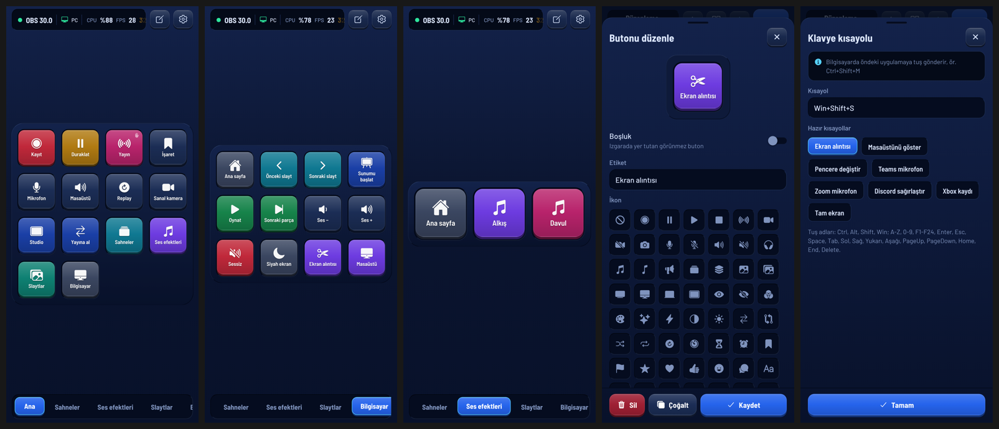
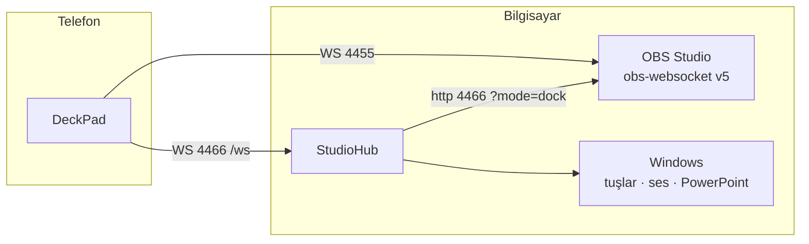
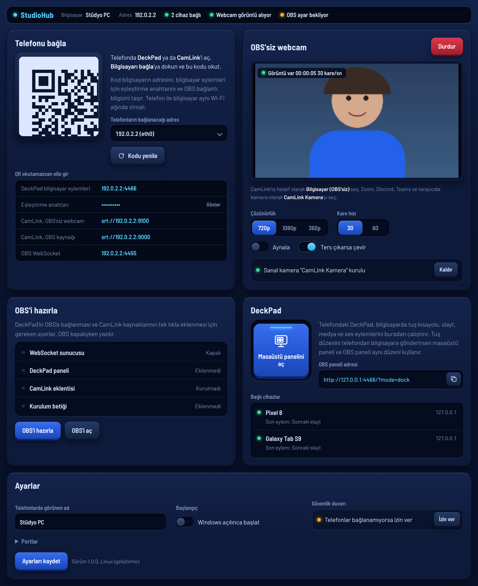
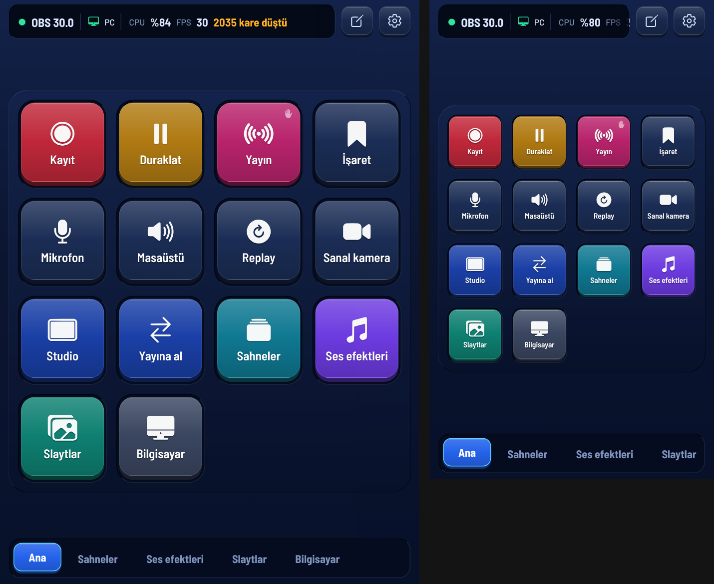

# DeckPad

## İndir

Üç adımda kurulum: **[mihrimatrix.github.io/deckpad](https://mihrimatrix.github.io/deckpad/)**

- Windows: **[StudioHub.exe](https://github.com/MihrimatriX/deckpad/releases/latest/download/StudioHub.exe)** (imzasız; SmartScreen uyarırsa **Ek bilgi › Yine de çalıştır**)
- Android: **[DeckPad.apk](https://github.com/MihrimatriX/deckpad/releases/latest/download/DeckPad.apk)** (Play Store dışı; 64 bit ARM telefonlar)

Telefonu OBS için bir Stream Deck'e çeviren Android uygulaması ve onun Windows yardımcısı **StudioHub**.
Tuşlar düzenlenebilir: sahne, kayıt/yayın, ses efektleri, slaytlar, filtreler ve çok adımlı makrolar.
StudioHub açıksa aynı tuşlar bilgisayarda da iş görür: sunumu ilerletme, klavye kısayolları, medya, Windows ses düzeyi.



Kardeş depo **[camlink](https://github.com/MihrimatriX/camlink)**: telefonu kablosuz kameraya çeviren uygulama ve CamLink OBS eklentisi.
Bu depoda webcam yok; yalnızca telefondan OBS'i ve bilgisayarı yönetmek var.

## Bu depoda

| Klasör | Ne | Teknoloji |
|---|---|---|
| [`app/`](app/) | **DeckPad**: telefon uygulaması; aynı kod bilgisayar paneli olarak web'e de derlenir | Expo SDK 58, React Native 0.88, TypeScript, zustand |
| [`studiohub/`](studiohub/) | **StudioHub**: Windows yardımcısı (bilgisayar eylemleri, masaüstü/OBS paneli, OBS'i hazırla) | .NET 10, ASP.NET Core (Kestrel), WPF + WebView2 |
| [`obs-script/`](obs-script/) | **OBS kurulum betiği**: DeckPad'in varsayılan tuşlarıyla uyumlu sahneleri, ses efektlerini ve slaytları kurar | Lua (obslua) |
| [`memory-bank/`](memory-bank/) | Projenin hafızası: kararlar, mimari, durum, öğrenilenler (yapay zekâ ve insan için) | Markdown |
| `scripts/` | `kur.ps1`: tek komutla kurulum (panel, StudioHub, isteğe bağlı telefon APK'si) | PowerShell |

## Parçalar nasıl konuşur



DeckPad OBS'e **doğrudan** bağlanır; StudioHub olmadan da tam çalışır. StudioHub yalnızca bilgisayar eylemleri ve bilgisayardaki paneller için gerekir.
Portlar, QR biçimi ve WebSocket mesajları: [`memory-bank/suite-contracts.md`](memory-bank/suite-contracts.md).

## Kullanım

1. **Kurulum (bir kez)**: depo kökünde `.\scripts\kur.ps1 -Apk`. Paneli derler, StudioHub'ı `C:\Apps\StudioHub`'a kurar, Başlat menüsüne ekler ve açar. Windows açılışında başlaması için StudioHub'da **Windows ile başlat**'ı aç.
   `-Apk` DeckPad'i derleyip USB'deki telefona yükler (telefonda USB hata ayıklama izni gerekir). Telefon takılı değilse APK `C:\Apps\StudioHub\DeckPad.apk`'de durur.
2. **OBS**: OBS kapalıyken StudioHub'da **OBS'i hazırla**, sonra **OBS'i aç**. WebSocket'i açar, DeckPad panelini ve kurulum betiğini OBS'e ekler.
3. **Telefon**: DeckPad'i aç; ilk açılışta kamera açılır, StudioHub'daki QR'ı okut. OBS ve bilgisayar tek seferde eşleşir; sonraki açılışlarda kendiliğinden bağlanır.
   İlk bağlantıda **Sahneler** ve **Ses efektleri** sayfaları OBS'teki sahne ve kaynaklarla dolar. Ana sayfadaki **Bildirim** tuşu yayında birkaç saniye yazı gösterir (yazıyı tuşu düzenleyerek değiştirirsin).

StudioHub olmadan: OBS › Araçlar › WebSocket Sunucu Ayarları › **Bağlantı bilgilerini göster**'deki QR'ı okut.
Ayrıntılı kullanım: [DeckPad](app/README.md) · [StudioHub](studiohub/README.md) · [OBS betiği](obs-script/README.md).

<table>
<tr>
<td width="50%"></td>
<td width="50%"></td>
</tr>
<tr>
<td>StudioHub: eşleştirme QR'ı, OBS'i hazırla (görüntü webcam kaldırılmadan önceki sürümden)</td>
<td>Aynı tuş düzeni bilgisayar penceresinde ve OBS'in içinde panel olarak</td>
</tr>
</table>

## Geliştirme

Gerekenler: Node.js 20+, .NET 10 SDK. Android derlemesi için JDK 17 ve Android SDK (ya da EAS bulut derlemesi).

```bash
# DeckPad
cd app
npm ci
npm run typecheck && npm test          # 25 test: sahte OBS ve sahte StudioHub'a karşı
npx expo start                         # Expo Go ile telefonda dene (yerel modül yok)

# StudioHub
cd app && npm run export:panel                                   # paneli derler → studiohub/web/panel
dotnet test studiohub/tests/StudioHub.Core.Tests
dotnet run --project studiohub/src/StudioHub.DevServer           # Linux/macOS'ta sahte platformla, http://127.0.0.1:4466/hub/
dotnet publish studiohub/src/StudioHub -c Release -o studiohub/out/StudioHub   # Windows için tek dosya, .NET gerektirmez
```

Windows'ta hepsi tek komut: `.\scripts\kur.ps1 [-Apk] [-Target C:\Apps\StudioHub]` (bkz. Kullanım).
APK elle: `cd app && npx expo prebuild -p android && cd android && ./gradlew assembleRelease` ya da `npx eas-cli@latest build -p android --profile preview`.

## Durum

| | Doğrulandı | Henüz denenmedi |
|---|---|---|
| DeckPad | 25 test; APK Windows'ta derlenip telefona kuruldu; OBS paneli gerçek OBS 32.2.2'de tuşlarla çalıştı (bildirim) | Telefonda QR ile bağlanma, iOS |
| StudioHub | 41 test; "OBS'i hazırla" dosyalarını gerçek OBS 30.0.2 okudu; Windows 11'de WPF kabuğu ve yönetim arayüzü açıldı | SendInput, Core Audio, PowerPoint, UAC; "OBS'i hazırla" OBS 32'de |
| OBS betiği | Gerçek OBS 30.0.2'de tüm adımlar, tekrar çalıştırma, efekt ve slayt tuşları | OBS 31+ |

Ayrıntı ve sıradaki adımlar: [`memory-bank/progress.md`](memory-bank/progress.md), [`memory-bank/activeContext.md`](memory-bank/activeContext.md).

## Yapay zekâ ile çalışma

Depo bir **hafıza bankası** ile gelir. Claude Code kökteki [`CLAUDE.md`](CLAUDE.md)'yi kendiliğinden okur; o da [`memory-bank/`](memory-bank/README.md)'ye yönlendirir.
Cline, Roo ya da Cursor'ın memory bank düzeniyle aynı dosya adları kullanılır. Her oturumun sonunda `activeContext.md` ve `progress.md` güncellenir;
mimari bir karar verildiğinde `decisions.md`'ye, çözülen her sinsi hata `lessons.md`'ye yazılır.

## Lisans

Tüm hakları saklıdır; bu depo kişisel kullanım içindir. Üçüncü taraf bileşenler kendi lisanslarıyla gelir:

| Bileşen | Lisans | Nerede |
|---|---|---|
| [Barlow](https://github.com/jpt/barlow) yazı tipleri | SIL OFL 1.1 | uygulama ve StudioHub arayüzü |
| npm ve NuGet paketleri | kendi lisansları | `package.json`, `*.csproj` |
