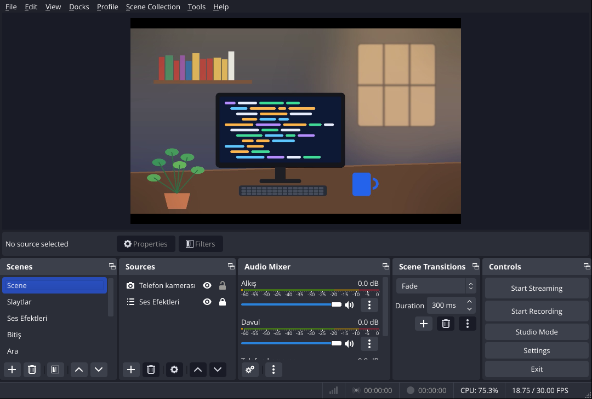

# OBS kurulum betiği

> Deponun genel tanıtımı için [kök README](../README.md).

`deckpad-camlink.lua`, DeckPad'in varsayılan tuşlarının beklediği sahne ve kaynakları OBS'te kurar. StudioHub'daki **OBS'i hazırla** betiği kendisi ekler; bu klasör elle kurmak ve geliştirmek için.

## Elle kurulum

OBS › **Araçlar › Betikler › +** ile `deckpad-camlink.lua`'yı seç. Sağdaki düğmeler:

| Düğme | Ne yapar |
|---|---|
| **Ses efektlerini ekle** | Seçilen klasördeki mp3/wav/ogg dosyalarını "Ses Efektleri" sahnesine ekler, bu sahneyi tüm sahnelere bağlar (efektler her sahnede duyulur). Efektler kendiliğinden çalmaz; DeckPad tuşuyla baştan oynar. |
| **Slaytları ekle** | Klasördeki görselleri "Slaytlar" sahnesindeki "Slayt gösterisi" kaynağına koyar (elle ilerletme). |
| **Telefon kamerasını bu sahneye ekle** | Geçerli sahneye "Telefon kamerası" ekler: CamLink eklentisi kuruluysa onun kaynağı, değilse SRT dinleyen Medya Kaynağı. |
| **Önerilen sahneleri oluştur** | Başlangıç, Kamera, Ekran, Ara, Bitiş. |

Düğmelere tekrar basmak güvenli; yalnız eksikler eklenir. DeckPad bağlanınca **Sahneler** ve **Ses efektleri** sayfaları bu sahne ve kaynaklarla kendiliğinden dolar; **Slaytlar** sayfasındaki Önceki/Sonraki tuşları "Slayt gösterisi"ni ilerletir.

Betik WebSocket'i açamaz (OBS'in betik API'sinde yok); onu StudioHub OBS'in ayar dosyasından yapar.

## Geliştirme notları

- Sahne ya da kaynak oluşturan her iş **düğme geri çağrısında ya da ön yüz olayında** (arayüz iş parçacığı) yapılır. `timer_add` geri çağrıları grafik iş parçacığında çalışır; orada sahne oluşturmak OBS'i kilitler.
- `OBS_ALIGN_*` sabitleri obslua'da yok; sayı olarak yazılır (CENTER 0, LEFT 1, TOP 4).
- OBS'te sahne ve kaynak adları aynı ad alanındadır: slayt kaynağı "Slayt gösterisi", sahnesi "Slaytlar".
- Adlar DeckPad'in varsayılan destesine bağlıdır ([`memory-bank/suite-contracts.md`](../memory-bank/suite-contracts.md) › OBS'teki adlar). Birini değiştirirsen `app/src/deck/defaults.ts`'i de değiştir.
- Otomatik deneme: OBS'i `DECKPAD_SETUP_SELFTEST="ses klasörü|slayt klasörü"` ortam değişkeniyle açarsan betik yüklenmesi bitince (FINISHED_LOADING) tüm adımları iki kez çalıştırır ve sonuçları OBS günlüğüne yazar.

